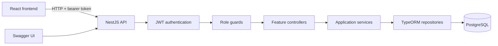
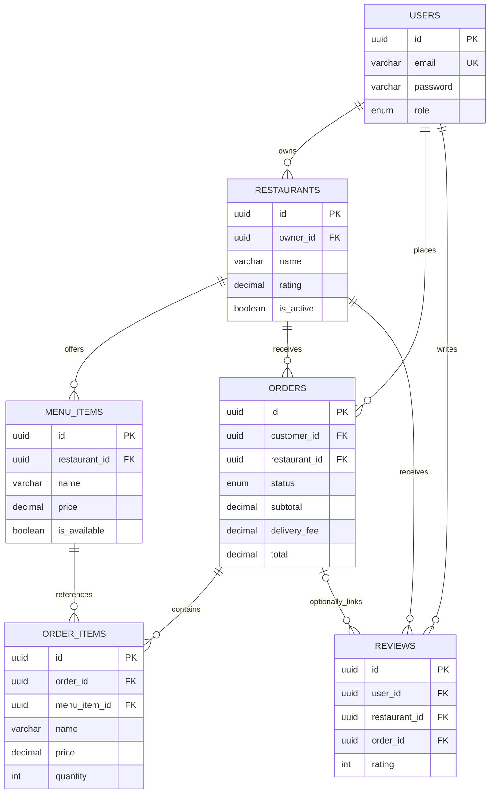

# Architecture

The React frontend and NestJS API live in separate repositories. REST endpoints under `/api` use TypeORM repositories to access PostgreSQL.

Validation rejects extra fields and invalid DTOs. A shared exception filter formats errors, and serialization excludes password fields from entity responses. JWT authentication precedes role authorization; order-detail access additionally checks customer or restaurant ownership.

## Data model

This diagram follows the foreign-key columns in the entity classes.

## Placing an order

1. The customer submits a restaurant, delivery address, and item IDs/quantities.
2. The service checks that each item exists, is available, and belongs to that restaurant.
3. It calculates the subtotal from stored prices and adds the delivery fee (15,000 VND when omitted).
4. It saves the order and item name/price snapshots, then returns the order with its relations.

Order creation currently performs separate saves for the order and its items. A transaction remains follow-up work; the diagram does not imply atomic persistence. Status updates accept declared enum values rather than enforcing a full transition graph.
